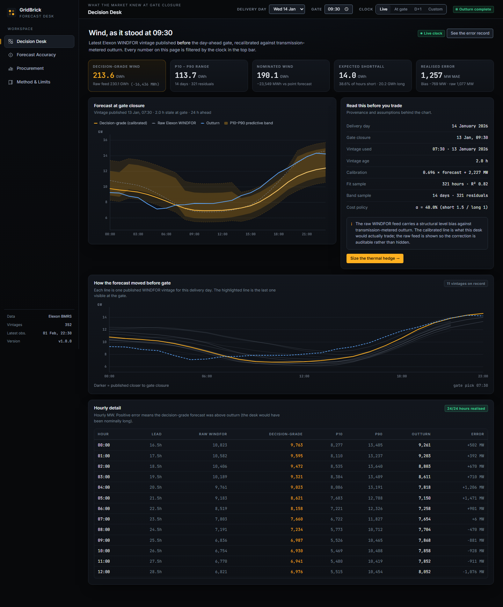
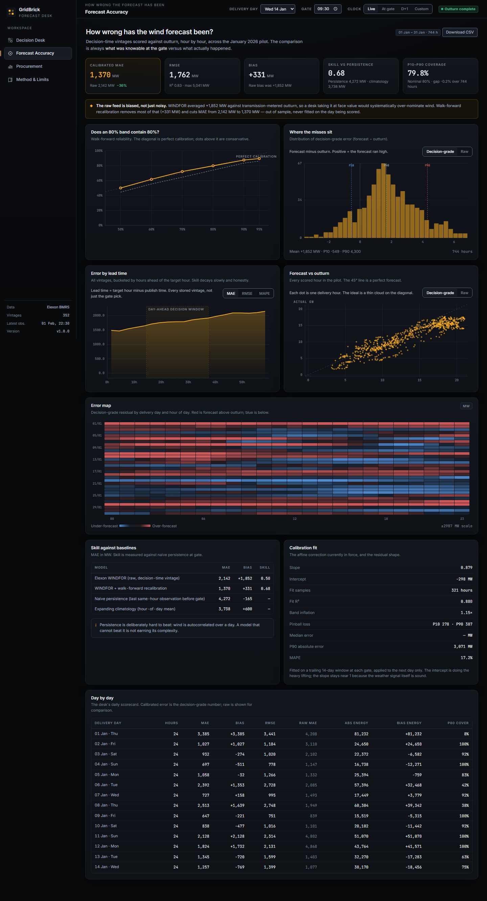
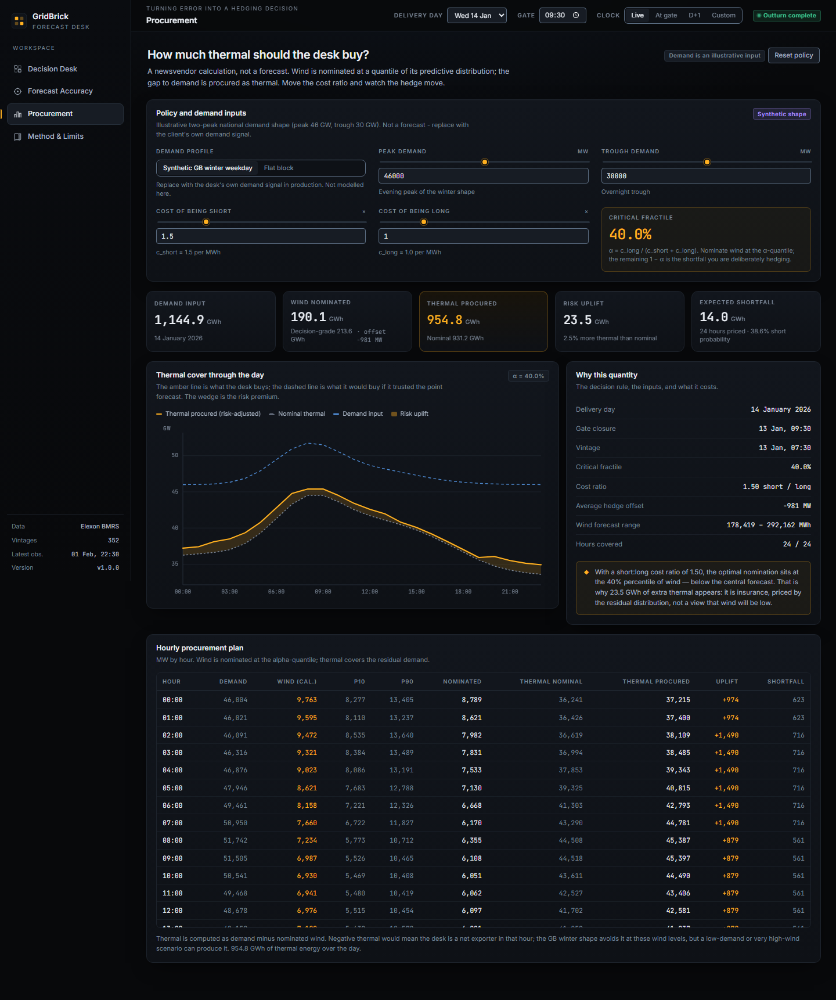

# GridBrick Forecast Desk

[](https://github.com/PRABAKAR05/gridbrick-wind-forecast-desk/actions/workflows/ci.yml)

**The latest Elexon wind forecast you could actually have seen at day-ahead gate closure, with its error quantified and turned into a number to trade.**

A UK energy supplier making January 2026 purchase decisions needs to answer two questions at 09:30 on D-1:

1. **What is the latest wind forecast available to me right now?**
2. **How wrong is that kind of forecast usually, and how should that change what I buy?**

Most forecast dashboards answer neither question honestly. They show the *latest* forecast from *today*, score it against *final* outturn, and quietly leak future information into the "backtest". GridBrick makes the decision-time constraint executable: every response is a pure function of `(data, as_of)`.

The pilot uses only Elexon wind data: `FUELHH` (transmission-metered wind outturn, 30-minute periods) and `WINDFOR` (hourly wind forecast vintages, with `publishTime`). It covers the 31 delivery days of January 2026.

**Repository:** <https://github.com/PRABAKAR05/gridbrick-wind-forecast-desk>  
**Live demo:** <https://nimble-savanna-6mdppyg.tmp.now> — anonymous Vercel preview. It returns 403 until claimed; see [Deployment](#deployment) for the claim link and the permanent-deploy command.

---

## Headline findings

| Measure (744 hourly comparisons) | Raw WINDFOR | Recalibrated | Change |
|---|---:|---:|---:|
| MAE | **2,142 MW** | **1,370 MW** | −36% |
| RMSE | 2,612 MW | 1,762 MW | −33% |
| Bias | **+1,852 MW** | **+331 MW** | −82% |
| R² | 0.803 | 0.826 | +0.023 |
| MAPE | 22.4% | 17.2% | −5.2 pp |

- **The dominant error is structural, not meteorological.** `WINDFOR` forecasts *total* wind; `FUELHH` measures *transmission-metered* wind. Comparing them directly leaves a +1.85 GW level bias. A trading desk using the raw feed believes there is 1.8 GW more wind than there is, buys too little thermal cover, and is short nearly every day.
- **A walk-forward affine recalibration removes most of it.** Fitting `outturn ≈ slope × forecast + intercept` on a trailing 14-day window of decision-time vintages cuts MAE by 36% and bias by 82%. The correction is fitted out-of-sample for each delivery day.
- **The P10–P90 band is close to nominal**, covering **79.8%** of outcomes against an 80% target. Tail bands are less reliable: 90% and 95% nominal intervals cover 87.6% and 89.5%. The product therefore presents P10–P90 as the operational band and flags the tail caveat.
- **The calibrated forecast still beats the obvious baselines.** Skill score **0.68** against persistence (4,272 MW MAE), and it also beats a 14-day hour-of-day climatology (3,738 MW MAE).
- **Quantified error changes the purchase.** For 14 January 2026, calibrated wind is 213.6 GWh, but the risk-adjusted nomination is **190.1 GWh**: 23.5 GWh less wind, and **23.5 GWh more thermal**, because a 1.5:1 short-to-long cost ratio makes the optimal nomination the 40th percentile, not the mean.

---

## Screens

### Decision Desk

The default view is the latest available decision. The clock control switches between **live**, **at gate closure**, **D+1**, and a custom instant. The forecast shown never changes when you move the clock after the gate; only the outturn and error fields appear.



### Accuracy

Raw versus recalibrated scorecards, error by hour of day, error by lead time, reliability, a day × hour residual heatmap, error distribution, and calibration scatter. Every chart is an SVG drawn from the API response; there is no chart library.



### Procurement

The newsvendor view: pick a demand shape and a short/long cost ratio, then see the wind nomination, thermal cover, expected shortfall, and the per-hour plan. Demand is an explicit input with two clearly labelled synthetic profiles, because the brief restricts the dataset to wind.



### Method

A plain-language explanation of the data, the point-in-time rule, the calibration and band construction, the procurement maths, and the limitations. This is the page to read before trusting any number.

---

## Why point-in-time correctness is the product

The assignment asks for the latest forecast *available at gate closure* and a quantitative evaluation of its error. That sounds simple, but three leaks are easy to introduce:

1. **Vintage leak.** `WINDFOR` publishes hourly vintages. Picking the latest row for a delivery hour uses a forecast published after the decision.
2. **Outturn leak.** `FUELHH` has its own `publishTime`. Scoring a decision with outturn that was not yet published at `as_of` is hindsight.
3. **Calibration leak.** Fitting the recalibration on the whole month and then scoring the whole month lets January's later days inform January's earlier decisions.

GridBrick closes all three:

- A vintage is eligible only if `publish_time < cutoff` (strict by default). At the 09:30 D-1 cutoff the usable vintage is normally the 07:30 run, a realistic **2.0 hours stale**.
- Actuals are filtered by their own `publish_time` at every point of use.
- Calibration and bands are fitted **walk-forward** on trailing windows, using only vintages and settled outturn available before the decision.

`backend/tests/test_api.py::test_point_in_time_forecast_is_invariant` asserts that the gate-time view and a later "live" view of the same delivery day return **identical** forecast-side numbers, and differ only in outturn fields.

### A subtlety worth calling out

`FUELHH` revisions overwrite the stored row; the warehouse keeps the latest value, not every revision. Loading actuals with an `as_of` filter at query time made the calibration fit depend on when a revision happened to land, producing a 66 MWh difference between two views of the same decision. The fix was to load the actual table in full and enforce visibility with `publish_time` at each use. The residual limitation is documented in [Method → Limitations](#limitations): there is no revision history, so the model sees final values for history days, never future days.

---

## Quick start

### Option A — Docker Compose (recommended)

```bash
docker compose up --build
```

Open **http://localhost:8088**. The backend seeds itself from `backend/seeds/*.jsonl.gz` on first boot, so no network or API key is required. The frontend is served by nginx, which proxies `/api` to the backend service.

The compose file uses port `8088` deliberately; `8080` is commonly occupied by other local services.

### Option B — local development

Backend (Python 3.13):

```bash
python -m venv .venv
# Windows: .venv\Scripts\activate
# macOS/Linux: source .venv/bin/activate
pip install -r backend/requirements-dev.txt
cd backend
uvicorn app.main:app --reload --port 8000
```

Frontend (Node 20.19+ / 22):

```bash
cd frontend
npm ci
npm run dev
```

Open **http://localhost:5173**. Vite proxies `/api` to `http://localhost:8000`. If your backend is elsewhere:

```bash
# Windows PowerShell
$env:VITE_PROXY_TARGET = "http://localhost:8010"
npm run dev
```

The API docs are at `http://localhost:8000/docs`.

### Tests and checks

```bash
cd backend
python -m pytest -q                 # 25 tests
python -m ruff check app tests scripts
cd ../frontend
npm run typecheck
npm run build
```

### Refreshing the data

The committed snapshot is enough to run and review. To pull from BMRS again:

```bash
cd backend
python scripts/ingest.py --from 2025-12-19 --to 2026-02-02
```

This uses `publishDateTimeFrom` / `publishDateTimeTo` and chunks the request into 7-day windows, because the BMRS range endpoints reject wider windows. Ingestion is idempotent (`ON CONFLICT` upserts), and the command re-exports the seed files.

Elexon documentation:

- [`FUELHH`](https://bmrs.elexon.co.uk/api-documentation/endpoint/datasets/FUELHH)
- [`WINDFOR`](https://bmrs.elexon.co.uk/api-documentation/endpoint/datasets/WINDFOR)

No API key is needed for either dataset.

---

## How it works

```
Elexon BMRS
  FUELHH (30-min outturn) ─┐
  WINDFOR (hourly vintages)─┤
                            ▼
                 idempotent ingestion
                 SQLite warehouse (UTC)
                            │
             ┌──────────────┴──────────────┐
             ▼                             ▼
   point-in-time dataset           committed seed snapshot
   (vintage < cutoff,              (deterministic cold start,
    actual publish_time <= as_of)   offline review)
             │
     ┌───────┼────────────┬─────────────────┐
     ▼       ▼            ▼                 ▼
  accuracy  bands     calibration      procurement
  metrics   (empirical (walk-forward    (newsvendor
            quantiles)  affine OLS)      quantile)
     │       │            │                 │
     └───────┴────────────┴─────────────────┘
                            ▼
                    FastAPI /api/v1
                            ▼
                 React + TypeScript SPA
```

### Stack

| Layer | Choice | Why |
|---|---|---|
| Frontend | React 18, TypeScript, Vite, TanStack Query | Fast SPA, typed wire contracts, cache by `(day, cutoff, as_of)` |
| Charts | Hand-built SVG | No chart library, full control of axes, tooltips and responsive layout |
| Backend | Python 3.13, FastAPI, Pydantic v2 | Typed contracts, async ingestion, automatic OpenAPI docs |
| Data | SQLAlchemy 2, SQLite, NumPy | Zero-ops local warehouse; analytical maths in NumPy |
| Packaging | Docker, Docker Compose, nginx | One-command local run; same image works on a container host |
| Deployment | Vercel Services (FastAPI + static Vite) | One project, one domain, `/api` routed to the backend |
| Tests | pytest, FastAPI TestClient, ruff | Domain maths, DST clock, API contract, point-in-time invariant |

### The analytics

**1. Hourly alignment.** `WINDFOR` is hourly. `FUELHH` is half-hourly; the two periods in each hour are averaged. Because the value is a mean MW over one hour, summing hourly MW gives MWh directly.

**2. Vintage selection.** For delivery day D and cutoff C, the eligible vintage is the latest `publish_time < C`. The default C is 09:30 Europe/London on D-1. The UI shows the chosen publish time and its staleness.

**3. Affine recalibration.** For each delivery day, fit

```
outturn ~ slope * forecast + intercept
```

on the trailing 14 days of decision-time vintages. The slope is bounded to `[0.4, 1.3]` and at least 120 samples are required. If the fit is unstable, the model falls back to a bias-only correction (slope = 1); if there is not enough history, it falls back to identity. The fit is applied out-of-sample to the delivery day.

This is a scope correction, not a claim that the weather model is wrong. It maps "total wind" onto "transmission-metered wind" using recent observed behaviour, and it adapts as the relationship drifts.

**4. Uncertainty bands.** Residuals (`calibrated forecast − actual`) from the trailing 14 settled days are pooled by 6-hour lead bucket. At least 48 samples are required. The empirical quantiles are inflated by 15% around the median to account for temporal clustering of errors; the inflation is a deliberate conservative choice, not a statistical guarantee.

**5. Procurement.** Let `F` be nominated wind and `W` outturn. With short and long imbalance costs `c_short` and `c_long`:

```
C(F) = c_short * E[(F - W)+] + c_long * E[(W - F)+]
```

The first-order condition gives the critical fractile:

```
P(W < F*) = c_long / (c_short + c_long)
```

With the default `c_short = 1.5`, `c_long = 1.0`, the fractile is **0.40**. The wind nomination is the 40th percentile of the predictive distribution, implemented as `calibrated forecast + offset`, where `offset = −q_{1−α}(ε)` and `ε = forecast − actual`. The offset is negative in the default case, so the desk deliberately under-nominates wind and buys more thermal as insurance.

Thermal baseline = demand − calibrated wind. Thermal procured = demand − risk-adjusted wind nomination. The difference is the risk uplift. Demand is an input, not a forecast; the app ships two synthetic profiles (`synthetic_gb_winter`, `flat`) and labels them as such.

The numbers are only as good as the cost ratio. The point is not that 1.5:1 is "correct"; it is that the app makes the cost assumption explicit and lets the user see how the quantity moves when it changes.

---

## API

All routes are under `/api/v1`. `as_of` is an ISO-8601 instant; naive values are treated as UTC.

| Method | Path | Purpose |
|---|---|---|
| GET | `/health` | Liveness and warehouse counts |
| GET | `/meta` | Pilot bounds, data bounds, defaults, demand profiles |
| GET | `/delivery-days` | Every pilot day with availability state |
| GET | `/decision/{delivery_date}` | Latest visible vintage, band, nomination, realised error |
| GET | `/decision/{delivery_date}/vintages` | Vintage evolution for the selected day |
| GET | `/accuracy/report` | Raw and calibrated scorecards, reliability, matrix, benchmarks |
| GET | `/procurement/profiles` | Available synthetic demand shapes |
| POST | `/procurement/plan` | Hourly wind + thermal plan for a demand profile and cost ratio |
| POST | `/admin/ingest` | Pull fresh BMRS data (admin token required when configured) |

Useful query parameters on `/decision`:

- `as_of` — the observer's clock; only data published on or before this instant is visible.
- `cutoff_hour`, `cutoff_minute` — local gate closure on D-1 (default 09:30).
- `c_short`, `c_long` — imbalance cost assumptions for the displayed nomination.

Example:

```bash
curl "http://localhost:8000/api/v1/decision/2026-01-14?as_of=2026-01-13T09:30:00Z"
```

---

## Repository layout

```
GridBrick/
├── backend/
│   ├── app/
│   │   ├── api/                 # FastAPI routers: decision, accuracy, procurement, system
│   │   ├── domain/              # Pure maths: settlement clock, metrics, calibration,
│   │   │                        # procurement, demand shapes
│   │   ├── services/            # Elexon client, ingestion, analytics, decision assembly,
│   │   │                        # bootstrap
│   │   ├── config.py            # Environment-driven settings
│   │   ├── db.py                # Engine/session, naive-UTC convention
│   │   ├── models.py            # WindActual, WindForecast, IngestionRun
│   │   ├── schemas.py           # Pydantic wire contracts
│   │   └── main.py              # App factory, CORS, gzip, timing, error handling
│   ├── seeds/                   # Committed gzipped JSONL snapshot (actuals + forecasts)
│   ├── scripts/                 # ingest.py, probe_data.py, smoke_api.py
│   ├── tests/                   # 25 tests: domain maths, DST, API, point-in-time invariant
│   ├── Dockerfile
│   ├── requirements.txt
│   └── requirements-dev.txt
├── frontend/
│   ├── src/
│   │   ├── api/                 # Typed client, TanStack Query hooks, wire types
│   │   ├── components/          # Layout, UI primitives, SVG chart shell
│   │   │   └── charts/          # Forecast band, vintages, heatmap, scatter, thermal, ...
│   │   ├── lib/                 # Chart scales, formatting, London wall time
│   │   ├── pages/               # DecisionDesk, Accuracy, Procurement, Method
│   │   ├── state/               # Hash router + shareable desk state
│   │   └── styles/              # Design tokens and responsive layout
│   ├── Dockerfile
│   ├── nginx.conf
│   └── package.json
├── docs/
│   ├── DEMO_SCRIPT.md           # 10-minute video run sheet
│   ├── DEPLOY.md                # Deployment and verification
│   ├── SUBMISSION.md            # Submission-form answers
│   └── screenshots/
├── docker-compose.yml
├── vercel.json                  # Vercel Services: Vite web + FastAPI api
├── .github/workflows/ci.yml
└── README.md
```

---

## Configuration

All settings use the `GRIDBRICK_` prefix and can be supplied as environment variables or in a root `.env` file.

| Variable | Default | Notes |
|---|---|---|
| `GRIDBRICK_ENVIRONMENT` | `development` | `production` on Vercel |
| `GRIDBRICK_DATABASE_URL` | `sqlite:///backend/data/gridbrick.db` | `/tmp/gridbrick.db` on Vercel |
| `GRIDBRICK_SEED_DIR` | `backend/seeds` | Committed snapshot |
| `GRIDBRICK_ELEXON_BASE_URL` | `https://data.elexon.co.uk/bmrs/api/v1` | BMRS base |
| `GRIDBRICK_PILOT_START` / `_END` | `2026-01-01` / `2026-01-31` | Delivery window |
| `GRIDBRICK_DEFAULT_CUTOFF_HOUR` / `_MINUTE` | `9` / `30` | Europe/London, D-1 |
| `GRIDBRICK_STRICT_CUTOFF` | `true` | Use `publish_time < cutoff` |
| `GRIDBRICK_BAND_LOOKBACK_DAYS` | `14` | Trailing window for bands |
| `GRIDBRICK_BAND_MIN_DAYS` | `5` | Minimum usable days |
| `GRIDBRICK_BAND_INFLATION` | `1.15` | Conservative band inflation |
| `GRIDBRICK_CORS_ORIGINS` | localhost origins | Comma-separated |
| `GRIDBRICK_ADMIN_TOKEN` | unset | Required by `/admin/ingest` when set |
| `GRIDBRICK_ALLOW_LIVE_INGEST` | `true` | Disable for an offline-only deployment |

Copy `.env.example` to `.env` if you want to override defaults locally.

---

## Deployment

The repository includes two deployment paths:

1. **Vercel Services** — one project, a Vite static service at `/` and the FastAPI service at `/api`. `vercel.json` is the whole configuration.
2. **Docker / Render / Heroku** — the backend image runs uvicorn on port 8000; the frontend image serves the SPA with nginx and proxies `/api`.

See [docs/DEPLOY.md](docs/DEPLOY.md) for exact commands, environment variables, cold-start behaviour, and verification steps.

**Live demo:** the current preview is an anonymous Vercel deployment. Anonymous deployments sit behind a claim wall; open the claim URL, sign in, and transfer the project to make the URL public and permanent.

- Claim URL: <https://vercel.com/claim-deployment?code=f0c6d54c-306b-4588-b5dc-ebf1ca189481>
- Temporary URL: <https://nimble-savanna-6mdppyg.tmp.now>

If the claim window has expired, `npx vercel deploy --temporary --yes` from the repository root creates a fresh one. After `vercel login`, `vercel --prod` deploys permanently.

---

## Limitations

These are intentional, documented boundaries rather than hidden assumptions.

- **One winter month, one country.** 31 delivery days and 744 hourly comparisons is enough to demonstrate the method, not enough to estimate a regime. A production desk would retrain across seasons and weather regimes.
- **The target is not the same quantity as the forecast.** `WINDFOR` is total wind; `FUELHH` is transmission-metered wind. The affine recalibration absorbs the average scope difference and any stable bias. It is not a causal correction, and it would fail if embedded/transmission metering changed sharply.
- **No revision history.** `FUELHH` revisions overwrite in place. History days use final values; visibility is still enforced by `publish_time`, and the final forecast-side numbers are invariant, but the app cannot reconstruct the exact revision state at a past instant.
- **Bands are empirical, not model-based.** Residual quantiles are pooled by 6-hour lead bucket with a 15% inflation. They are honest about the observed sample, not a guarantee. The 90% and 95% tails are under-covered (87.6% and 89.5% observed), so the UI treats P10–P90 as the operational band.
- **Demand is synthetic.** The brief restricts the data to wind, so demand is an explicit input with two labelled profiles. No demand forecast, prices, other fuels, interconnectors, or unit-level constraints are modelled.
- **Costs are assumptions.** `c_short` and `c_long` are relative imbalance costs, not live market prices. The procurement quantity is a sensitivity, not a trading instruction.
- **SQLite on serverless is ephemeral.** The Vercel function rebuilds the warehouse from the committed seed on a cold start. That is fine for a demo and deterministic; it is not a multi-user production database.
- **No intraday re-optimisation.** The model evaluates the day-ahead decision. It does not model later gate closures, perfect foresight, or continuous trading.

---

## Quality and verification

- 25 backend tests: affine fit guard rails, newsvendor signs, exposure split, metrics, DST settlement clock, API contract, point-in-time invariant, bad-input rejection.
- `ruff check` clean; TypeScript `tsc --noEmit` clean; production build passes.
- `backend/scripts/smoke_api.py` hits every route and asserts the response contract.
- End-to-end checked in Docker Compose through nginx: page, assets, SPA fallback, and API.
- Responsive checks at 1440 px and 390 px; no horizontal overflow, no console errors.
- CI workflow runs backend tests/lint and frontend typecheck/build on every push.

The two defects found during review are worth recording because they were real, not cosmetic:

1. The procurement planner initially used the **raw** forecast as its basis instead of the calibrated one. Fixed and covered by `test_build_plan_uses_the_calibrated_forecast_as_basis`.
2. The hedge offset had an inverted sign, which would have *increased* the wind nomination when shortfall was expensive. Fixed and covered by `test_hedge_offset_has_the_right_sign`.

---

## AI tool usage

AI was used substantially and is disclosed here as the brief requires.

- **Coding assistant:** OpenCode running DeepSeek V4.1 Flash Free. It was used for architecture exploration, first-pass implementation, test generation, refactoring, UI copy, and documentation.
- **UI review skills:** `s0xdk/refactoring-ui` and `arla6ka/ui-review` were used to review layout, contrast, spacing, chart axes, and responsive behaviour.
- **Human/AI division:** the product framing, data-source choices, point-in-time contract, model design, and final numerical claims were directed and checked by the author. AI-generated code was not accepted on trust: the analytics were reproduced against raw BMRS responses, the invariants are enforced by tests, and the deployment was exercised end to end.
- **No synthetic data is presented as Elexon data.** The only synthetic inputs are the two demand profiles, and they are labelled synthetic in the API, the UI, and this README.
- **No fabricated results.** All numbers above come from the committed seed and the running API. The seed itself is a snapshot of the BMRS endpoints named in this README.

---

## Assignment context

Built for the UK energy-utility product brief within a 16-hour time box. The prioritisation was deliberate: correctness of the decision-time contract and the forecast-error maths first, a complete and legible product surface second, deployment and documentation third. The main trade-off is sample size: one month of winter data demonstrates the method, but a real desk would demand more history before sizing a position from it.

## License

MIT. See [LICENSE](LICENSE).
